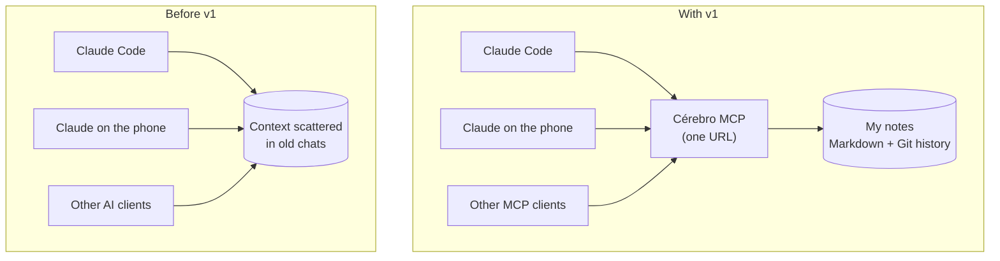
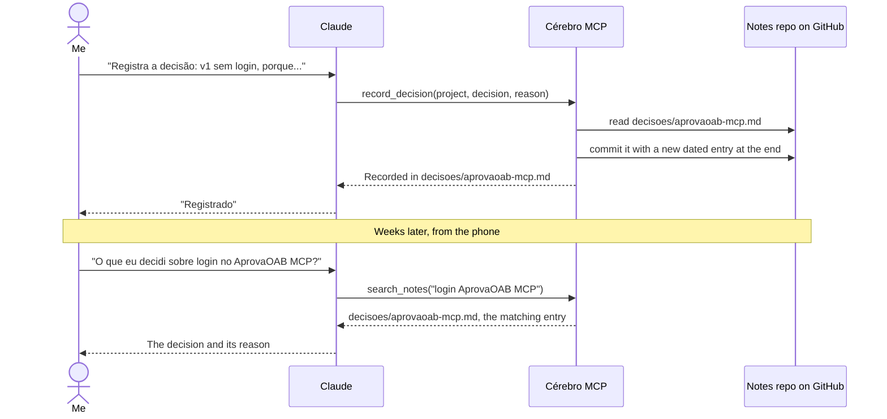

# PRD: Cérebro MCP v1

| | |
|---|---|
| **Status** | Draft |
| **Author** | Pedro Nunes |
| **Date** | 2026-11-25 |
| **Spec** | [Spec v1](../spec/v1.md) |

## Problem

What I know is spread across projects, chats and tools. I run a SaaS (AprovaOAB), study for certifications, test business ideas with AI agents, and use several AI clients every day: Claude Code on the computer, Claude on the phone, agent orchestrators. Three things keep going wrong:

1. **Every AI starts from zero.** Project context, past decisions and lessons live in old chats or in my head, so each new session needs them explained again.
2. **Decisions get lost.** A decision made in one chat stays in that chat. Weeks later I can't find what I decided, or why.
3. **Ideas captured away from the computer don't reach my notes.** An idea dictated to the phone stays in that conversation.

## Context: before and after

## Users

One user: me, through Claude Code, the Claude app (phone and web) and, if my plan allows custom connectors, ChatGPT.

## Goals

| ID | Goal |
|---|---|
| G1 | Reach the same notes from any MCP client with one URL. |
| G2 | Capture ideas and decisions from any client, including the phone. |
| G3 | Find notes by meaning: "o que eu decidi sobre o plano grátis?" finds the right decision. |
| G4 | Never lose a note: every change is a Git commit and can be undone. |
| G5 | Zero cost: runs on Cloudflare's free plan. |
| G6 | Every decision documented in an ADR, and search quality and latency measured, so v2 has a baseline to beat. |
| G7 | I can explain every line: built in small PRs that I review and question before merging. |

## Non-goals for v1

These are deliberate. v1 is meant to show, through real use, which problems the v2 architecture has to solve.

- Real authentication (OAuth). v1 uses a secret URL.
- Keyword or hybrid search. v1 searches by meaning only.
- Protection against two agents overwriting each other's edits, beyond what GitHub's `sha` check gives for free.
- Retries, queues or a scheduled repair of the search index.
- Moving notes.
- More than one user, a UI, a local sync on the computer, and sources other than my notes.

## User stories

1. From my phone: "salva essa ideia: …" becomes a dated note in `ideias/`.
2. In Claude Code, working on AprovaOAB: "o que eu já decidi sobre o plano grátis?" gets an answer that cites `decisoes/aprovaoab.md`.
3. "Registra a decisão: a v1 do AprovaOAB MCP não terá login, porque …" appends a dated entry to `decisoes/aprovaoab-mcp.md`.
4. I edit notes in Obsidian or on GitHub and push; search finds the change within a couple of minutes.
5. Before and after any change to search, I run the eval and compare the numbers.

### Story 3, step by step

## Requirements

### Functional

| ID | Requirement |
|---|---|
| FR1 | List notes (optionally under a folder) and read a note by path. |
| FR2 | Search notes by meaning, returning the best passage of each matching note. |
| FR3 | Save an idea as a new dated note, never overwriting another idea. |
| FR4 | Record a decision as a dated entry in the project's decision log. |
| FR5 | Create, overwrite, edit a passage of, and delete any note. |
| FR6 | Every change to the notes, made through MCP or pushed from anywhere, reaches search, deletions included. |
| FR7 | Rebuild the search index on demand. |

### Non-functional

| ID | Requirement |
|---|---|
| NFR1 | Without the secret URL, the server answers `404`, as if it didn't exist. |
| NFR2 | Every write is one Git commit. |
| NFR3 | The search index is derived data: it can be rebuilt from the notes at any time, and indexing twice changes nothing. |
| NFR4 | A change reaches search within about two minutes. |
| NFR5 | Paths are validated on every read and write; nothing outside the notes repo can be reached. |
| NFR6 | Runs within Cloudflare's free plan. |
| NFR7 | Logs never contain note content, queries, secrets or request URLs. |

### Engineering

| ID | Requirement |
|---|---|
| E1 | Tests from the first PR; every PR runs typecheck and tests in CI; merging to `main` deploys. |
| E2 | Resources come from `wrangler.jsonc` and an idempotent setup script; secrets never live in the repo. |
| E3 | Every design decision is an ADR, written in the PR that implements it. |
| E4 | Every PR lists the questions its reviewer must be able to answer ([CLAUDE.md](../../CLAUDE.md)). |
| E5 | Code, docs and tool descriptions in English; notes in Portuguese. |

## Priority

The build order is the PR plan in [spec §12](../spec/v1.md#12-build-plan). If time runs short: the end-to-end slice (PR 1) and capture (PR 2) first, search (PRs 3 and 4) next, measurements and docs last.

## Success criteria

- The same URL works in Claude Code and the Claude app, with no client-specific changes.
- An idea saved from the phone is in the notes repo, and findable by meaning within about two minutes.
- A note deleted on GitHub stops showing up in search after the push.
- The eval and the latency measurements have real numbers in the spec.
- For every merged PR, I answered its reviewer questions.

## Known limitations (on purpose)

Each one is a lesson for v2. [Spec §10](../spec/v1.md#10-known-limitations-on-purpose) says how each will show up in real use.

| Limitation | What it will look like | Direction for v2 |
|---|---|---|
| Secret in the URL | Whoever has the URL can read, edit and delete everything | OAuth |
| Search by meaning only | Names and acronyms ("CLF-C02", "RRF") are often missed | Hybrid search |
| No retries on indexing | A failed webhook leaves search stale, silently | A queue with retries, plus a scheduled repair |
| `write_note` overwrites blindly | Two agents editing the same note: one edit disappears | A version check on overwrite |
| Reindex only adds and updates | A note deleted while the webhook was down stays in search | A real rebuild |
| Free plan limits | Big pushes or reindexes need batching | The paid plan, or a queue |

## Open questions

1. Names: `cerebro-mcp` for the code (public) and `cerebro-notas` for the notes (private)?
2. Folders to start with: `ideias/`, `decisoes/`, `projetos/`, `estudos/`. Anything else?
3. Does my ChatGPT plan allow custom MCP connectors? If not, v1 targets Claude Code and the Claude app only.

## Next: v2 candidates

Decided only after living with v1, with an ADR per change: OAuth, hybrid search, a version check on overwrite, indexing through a queue with a scheduled repair, moving a note in one commit, and an MCP prompt for a weekly review of what changed.

## Related

- [Spec v1](../spec/v1.md)
- [CLAUDE.md](../../CLAUDE.md)
- Inspired by [YudiG12/second-brain-mcp](https://github.com/YudiG12/second-brain-mcp): the same platform and the same path from a simple v1 to a robust v2, with my own code, decisions and notes.
