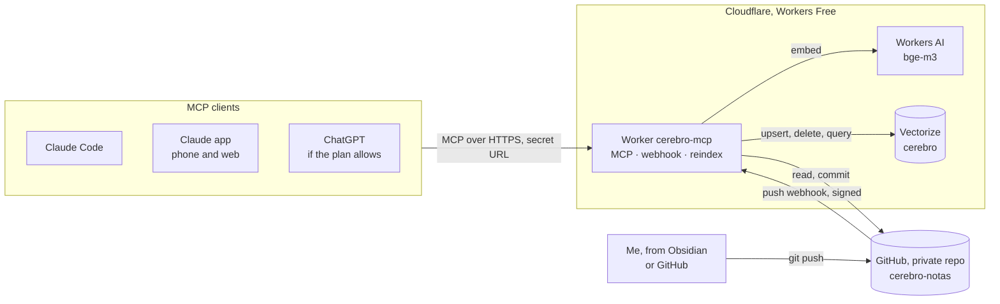
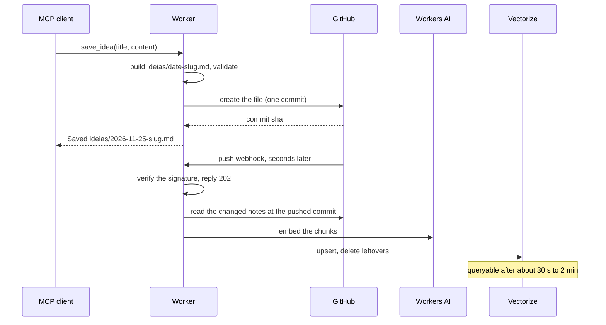

# Spec: Cérebro MCP v1

| | |
|---|---|
| **Status** | Draft: the target for the v1 build. Updated in the same PR as any change that departs from it. |
| **Author** | Pedro Nunes |
| **Scope** | How v1 works. |
| **PRD** | [PRD v1](../prd/v1.md) |
| **Decisions** | The ADRs in §13, each written in the PR that implements it |

## 1. Architecture



| Component | Role |
|---|---|
| Worker `cerebro-mcp` | MCP server (8 tools), GitHub webhook receiver and admin reindex. Stateless: every request reads what it needs from GitHub or Vectorize. |
| GitHub repo `cerebro-notas` (private) | The notes, in Markdown. Source of truth: every change is a commit. |
| Workers AI, `@cf/baai/bge-m3` | Embeddings, 1024 dimensions. Multilingual, because the notes are in Portuguese. |
| Vectorize `cerebro` | Semantic index, cosine. Derived data: it can be rebuilt from the repo at any time. |

## 2. Endpoints

| Route | Method | Auth | What it does |
|---|---|---|---|
| `/<MCP_TOKEN>/mcp` | MCP (Streamable HTTP, stateless) | The secret in the path | Serves the tools (§3). |
| `/github-webhook` | `POST` | HMAC-SHA256 signature in `X-Hub-Signature-256`, keyed with `WEBHOOK_SECRET` | Indexes the notes changed by a push (§5.2). A bad or missing signature gets `401`. |
| `/admin/reindex` | `POST` | `Authorization: Bearer <ADMIN_SECRET>` | Indexes one page of notes (§5.3). |

Anything else, including `/mcp` with a wrong token, returns `404`. The webhook and the admin route have their own secrets, so the MCP token never ends up in GitHub's webhook settings or delivery logs (ADR 004). Every secret is compared in constant time.

## 3. Tools

| Tool | Input | Behavior | Kind |
|---|---|---|---|
| `list_notes` | `prefix?` | Paths of every note on `main` (§4.1), optionally only those whose path starts with `prefix`: a folder (`decisoes/`) or the start of a path (`ideias/2026-11`). One GitHub call (the recursive tree). A repo with no notes, or with no commits yet, gets "no notes yet", not an error. | read-only |
| `read_note` | `path` | The full note. | read-only |
| `search_notes` | `query`, `limit?` (1–10, default 5) | Search by meaning (§5.4). Per note: its best passage, that passage's heading and the score. Always returns the closest notes, related or not (§10). | read-only |
| `save_idea` | `title`, `content` | Creates `ideias/YYYY-MM-DD-<slug>.md`, dated in São Paulo time. Never overwrites: if the path exists, it tries `-2`, `-3`… up to 20. | creates |
| `record_decision` | `project`, `decision`, `reason` | Appends a dated entry to `decisoes/<project-slug>.md`, creating the file if needed (§5.5). | creates |
| `write_note` | `path`, `content` | Creates a note, or overwrites it whole against whatever version is on `main` at that moment (§6). | destructive |
| `edit_note` | `path`, `old_text`, `new_text` | Replaces a passage that must appear exactly once. An empty `new_text` deletes it. | destructive |
| `delete_note` | `path` | Deletes a note. It stays in the Git history. | destructive |

**Annotations.** read-only: `readOnlyHint: true`. creates: `readOnlyHint: false, destructiveHint: false`. destructive: `destructiveHint: true`, and `delete_note` also `idempotentHint: true`. All `openWorldHint: false`. They are hints for clients (parallel reads, when to ask for approval), not a security control.

**Descriptions** are part of the design: the model reads them to choose a tool. The three that matter most:

- `search_notes`: "Searches my notes by meaning and returns, per note, the best passage and its section. Use it before answering anything about my projects, decisions, studies or ideas. The closest notes always come back, even when none is relevant: judge them before using them. To read a whole note, call read_note."
- `save_idea`: "Saves a new idea as a dated note in ideias/. Use it when I say 'salva essa ideia' or share an idea to keep. Never overwrites another idea."
- `record_decision`: "Records a decision about a project, with its reason, as a dated entry in decisoes/<project>.md. Use it when I state a decision ('decidi…', 'vamos com…'). Keep the project name consistent: call list_notes with prefix 'decisoes/' to see the existing ones."

**Path rules**, for every read and write: relative; ends in `.md`; at most 200 characters; no `..`, `.` or empty segments; no leading `/`; no backslash or control characters. Each segment is URL-encoded when the GitHub API URL is built, so a path can never reach another endpoint.

**Slugs** (`save_idea`, `record_decision`): lowercase, accents removed, anything that isn't a letter or digit becomes `-`, repeated `-` collapsed, at most 60 characters. An empty idea slug becomes `sem-titulo`; an empty project slug is an error ("the project name needs letters or digits").

**Write results:** `Saved: <path> (commit <short sha>)`, `Recorded in <path>`, `Edited: <path>`, `Deleted: <path>`, each followed by "search catches up within a couple of minutes".

## 4. Data model

### 4.1 Notes

Markdown files in the private repo `cerebro-notas`, branch `main`. Suggested folders: `ideias/`, `decisoes/`, `projetos/`, `estudos/`; any folder is allowed, and no front matter is required.

A note is a `.md` file with no path segment starting with `.`, so Obsidian's `.obsidian/` and `.trash/`, `.github/` and hidden files aren't notes. One function (`isNote`) decides it, for `list_notes` and for indexing (§5.2, §5.3), so the list and search always agree. Commits made through MCP use the message `<tool>: <path>`, e.g. `save_idea: ideias/2026-11-25-cerebro-mcp.md`.

A decision log (`decisoes/<project-slug>.md`) has one heading per decision:

```markdown
# Decisões: aprovaoab-mcp

## 2026-11-25: v1 sem login

As provas e os gabaritos são públicos na FGV; o que é pago é o diagnóstico.
```

### 4.2 Vectors (Vectorize `cerebro`)

| Field | Value |
|---|---|
| `id` | `<first 12 bytes of SHA-256(path), in hex>:<chunk number>`. Vectorize ids are capped at 64 bytes, and paths can be longer. |
| `values` | 1024 numbers from bge-m3 |
| `metadata.path` | The note's path |
| `metadata.seq` | The chunk number |
| `metadata.heading` | The section's heading, or the note's title for text before the first heading |
| `metadata.text` | The first 1,000 characters of the chunk, so results need no extra GitHub call |

### 4.3 Chunking, by heading

1. Split the note at Markdown headings (`#` to `###`). Each section is one chunk.
2. A section longer than 1,000 characters is split at blank lines into pieces of up to 1,000 characters; a single longer paragraph is a piece of its own.
3. The text embedded for each chunk starts with `<note title> > <heading>`, so a passage carries its context.
4. At most 40 chunks per note. The rest isn't indexed, and the indexer logs `note_too_long` with the path.

Why by heading and not by size alone (ADR 006): notes are organized by headings, and a decision log has one heading per decision, so search returns exactly the decision that was asked about.

## 5. Flows

### 5.1 A write (`save_idea`)



Tools never index. Indexing happens only through the push webhook, which GitHub also sends for commits made through its API (ADR 005). A tool answers as soon as GitHub confirms the commit.

### 5.2 Indexing from the push webhook

1. Verify `X-Hub-Signature-256`: HMAC-SHA256 of the raw body with `WEBHOOK_SECRET`, compared in constant time. Bad or missing: `401`.
2. A `ping` event gets `200`. Other events, and pushes to branches other than `main`, get `202` and are ignored.
3. Reply `202` at once, and do the rest in the background (`ctx.waitUntil`).
4. Collapse the push's commits into one final state per note (§4.1): the last change wins, so a file added and then removed is just removed.
5. Removed: delete ids `<hash>:0` to `<hash>:39`. Added or modified: read the file at the push's `after` commit, chunk it (§4.3), embed all its chunks in one Workers AI call, upsert them, and delete the ids left over from a longer version.
6. At most 20 notes per push, to stay under the free plan's limit on outside calls per invocation (about 50; check the current number). Past that, log `push_too_large` with the count and stop: run the reindex (§5.3).
7. Nothing retries a failure (§10). It's logged as `index_failed` with the path, and that note stays stale in search.

### 5.3 Reindex

`POST /admin/reindex?cursor=<n>` lists every note (one call), indexes 20 of them starting at position `n`, and returns `{ "indexed": 20, "next_cursor": 40 }`, with `next_cursor: null` at the end. `scripts/reindex.mjs` calls it until `next_cursor` is `null`. It only adds and updates: the vectors of notes deleted while the webhook was down remain (§10).

### 5.4 Search by meaning

Embed the query with bge-m3, ask Vectorize for the 20 closest chunks with their metadata, keep the best chunk per note, and return the top `limit` notes with path, heading, score and text. v1 has no similarity floor, so the closest notes come back even when nothing is related (§10).

### 5.5 Recording a decision

1. Slug the project name; the path is `decisoes/<slug>.md`.
2. Read the file and its `sha` in one call. If it doesn't exist, create it with `# Decisões: <project>` and the entry.
3. Append `## YYYY-MM-DD: <decision>`, a blank line and `<reason>`, and commit with that `sha`.
4. If GitHub answers `409` (the file changed in between), go back to step 2, up to 3 times. Retrying is safe: appending to the newer version keeps both changes.

## 6. Consistency and concurrency

| Question | Answer |
|---|---|
| Source of truth | `main` in `cerebro-notas`. The index can lag and can be rebuilt. |
| Read after write | `read_note` and `list_notes` read GitHub, so they see a commit at once. Search sees it after the webhook (seconds) plus Vectorize applying the write (about 30 s to 2 min). |
| Two writes to the same note | It depends on the tool, on purpose: see below. |

| Tool | How it writes | Two agents at once |
|---|---|---|
| `edit_note` | Reads the content and its `sha` together, commits with that `sha` | The second gets `409`; the tool answers "the note changed, read it again" and writes nothing. Safe. |
| `record_decision` | Same, and retries on `409` | Both entries land. Safe, because an append can be re-applied. |
| `delete_note` | Commits the deletion with the current `sha` | Deletes whatever is on `main`; the content stays in the history. |
| `write_note` | Fetches the current `sha` right before committing | **Overwrites.** If the note changed after the agent read it, that change is lost. A v1 limitation, fixed in v2 by a version check (§10). |

## 7. Security

- **Who can call the tools:** anyone with the URL, which carries a 192-bit random token. There is no identity and no per-client revocation; rotating the token means reconnecting every client (ADR 004, until OAuth in v2).
- **The token can leak through logs and traces**, because it's in the URL: Cloudflare's invocation logs and traces stay off (both record the URL), so does Issues (its error reports keep request details), and the MCP route writes no logs at all, since Cloudflare's docs don't say whether a log line keeps the request's path.
- **Webhook:** only GitHub can trigger indexing (HMAC), and the MCP token isn't stored in GitHub's settings.
- **The Worker's access to GitHub:** a fine-grained token for `cerebro-notas` only, with Contents read and write and an expiry date.
- **Paths** are validated and URL-encoded on every read and write (§3).
- **Notes are data, never instructions:** tools return them as text and act on nothing written inside them.
- **Secrets** (`MCP_TOKEN`, `GITHUB_TOKEN`, `WEBHOOK_SECRET`, `ADMIN_SECRET`) live only in Worker secrets and the gitignored `.dev.vars`. I set them myself with `wrangler secret put`: never in a chat, a committed file or a command argument.

## 8. Configuration and deploy

| Item | Value |
|---|---|
| Plan | Cloudflare Workers Free |
| `wrangler.jsonc` | Worker `cerebro-mcp`, `main: src/index.ts`, `account_id`, the `nodejs_compat` flag (the `agents` handler uses `AsyncLocalStorage`), observability on with invocation logs, traces and Issues off. From PR 3: AI binding `AI`, Vectorize binding `VECTORS` (index `cerebro`) |
| Vars | `NOTES_REPO` (`<github-user>/cerebro-notas`), `NOTES_BRANCH` (`main`); from PR 2, `TIMEZONE` (`America/Sao_Paulo`) |
| Secrets | `MCP_TOKEN` (48 hex characters), `GITHUB_TOKEN`; from PR 3, `WEBHOOK_SECRET`, `ADMIN_SECRET`. Not listed in `wrangler.jsonc`: `secrets.required` would make `wrangler deploy` fail until they exist, and the first deploy comes before them |
| Libraries | The official MCP TypeScript SDK (`@modelcontextprotocol/server`, v2) for the server and tools; `createMcpHandler` from Cloudflare's `agents` package (`agents/mcp/server`) for stateless Streamable HTTP, serving 2025-era and 2026-07-28 clients at the same URL; `zod` for inputs |
| Setup | `scripts/setup.mjs`, in Node so it runs the same on Windows and on Linux (ADR 008). Idempotent: it lists the secrets the Worker still lacks and prints the steps for me to do by hand; from PR 3 it also creates the Vectorize index (1024 dimensions, cosine) if it's missing, and prints the webhook steps |
| CI | GitHub Actions: typecheck and tests on every PR; merging to `main` deploys, with `CLOUDFLARE_API_TOKEN` in the repo's Actions secrets |
| Connecting | The Claude app (desktop, Claude Code in it included, and phone): a custom connector with the URL. The Claude Code CLI: `claude mcp add --transport http cerebro <URL>`, with the URL read from a prompt (`$url = Read-Host`) rather than typed into a command, so the token stays out of the shell history. |

## 9. Tests

| Layer | Tool | Covers |
|---|---|---|
| Unit | Vitest | Path rules, slugs, chunking by heading, the decision entry format, signature checks (valid, invalid, missing), collapsing a push into final states, grouping search results by note |
| Integration | Vitest with `@cloudflare/vitest-plugin` (runs inside workerd) | Each tool end to end against an in-memory fake of GitHub (contents, tree and `sha` checks), through the official MCP client in both protocol eras; `edit_note` on `409`; `record_decision` retrying on `409`; `save_idea` suffixes; webhook to index to search, with Workers AI and Vectorize stubbed; reindex pages; `404` on a wrong token; no logs from the MCP route |
| Regression | One per bug fixed after v1 | Fails before the fix, passes after |

Tests never reach the network.

## 10. Known limitations (on purpose)

v1 keeps these on purpose, to hit each one in real use before v2 fixes it. Each gets an issue when it shows up, and an ADR when it's fixed.

| Limitation | How it will show up | How to reproduce or measure |
|---|---|---|
| Secret in the URL | It's pasted into every client, and anyone who has it has full access | — |
| Search by meaning only | Names and acronyms ("CLF-C02", "RRF") are often missed | The eval: `exact` cases score lower than `meaning` (§11) |
| No similarity floor | A question about something that isn't in the notes still returns notes | Ask about a topic you never wrote about |
| No retries on indexing | A failed webhook leaves a note stale, silently | Find the failed delivery in GitHub's webhook log, then search for that note |
| `write_note` overwrites blindly | Two agents editing one note: one edit is lost | Two Claude Code sessions overwriting the same note |
| Reindex only adds and updates | A note deleted while the webhook was down stays in search | Turn the webhook off, delete a note, reindex, search |
| Free plan limits | A push with more than 20 notes isn't fully indexed | Push 25 notes at once |
| `list_notes` reads one recursive tree | Past 100,000 files or 7 MB, GitHub cuts the tree short and `list_notes` leaves notes out, silently | Not expected with personal notes; GitHub marks it with `truncated: true` |

## 11. Measurements and evals

### 11.1 Search eval

`scripts/eval.ts` runs a golden set through `search_notes` on the live server and prints recall@5 and MRR, overall and per kind, followed by the misses. The golden set is private (`~/.config/cerebro/golden.jsonl`, outside the repo) because it holds my own questions: 30 or more cases, written after the notes exist.

```json
{"query": "o que eu decidi sobre o plano grátis?", "expected": "decisoes/aprovaoab.md", "kind": "meaning"}
{"query": "CLF-C02", "expected": "estudos/aws-cloud-practitioner.md", "kind": "exact"}
```

| Kind | recall@5 | MRR |
|---|---|---|
| `meaning` | _to measure_ | _to measure_ |
| `exact` | _to measure_ | _to measure_ |
| All | _to measure_ | _to measure_ |

This is v2's baseline: hybrid search has to beat it, above all on `exact`.

### 11.2 Latency

`scripts/measure.ts`, from my computer (network included), 10 runs each; p50 / p90 / max.

| Metric | How | v1 |
|---|---|---|
| Write | `save_idea` response time | _to measure_ |
| Write to searchable | Save, then poll `search_notes` every 3 s until the note comes back | _to measure_ |
| Search | `search_notes` response time | _to measure_ |

### 11.3 Cost

After a month, from the Cloudflare dashboard. Expected: zero on the free plan.

## 12. Build plan

Every PR follows [CLAUDE.md](../../CLAUDE.md): failing tests first, a review by a separate agent with a clean context, then mine, answering the PR's reviewer questions.

| PR | Scope | Done when | What I learn |
|---|---|---|---|
| 1 | Skeleton: `wrangler.jsonc`, TypeScript strict, Vitest, CI, `setup.mjs`, the token route and `list_notes` | Deployed, and Claude Code lists my notes | The MCP protocol, Workers, bindings, deploying |
| 2 | `read_note`, `save_idea`, `record_decision`, `write_note`, `edit_note`, `delete_note`, path rules; the `TIMEZONE` var | From the phone, an idea and a decision land in the repo | GitHub's API, optimistic concurrency with `sha` |
| 3 | Webhook: signature, collapsing a push, chunking, embeddings, Vectorize; the reindex; the `AI` and `VECTORS` bindings, and `setup.mjs` creating the index | A pushed note gets indexed, and a deleted one leaves the index | Webhooks and HMAC, embeddings, idempotency |
| 4 | `search_notes` | "O que eu decidi sobre…" finds the decision | Vector search, chunking trade-offs |
| 5 | `eval.ts`, `measure.ts` and the golden set; numbers in §11 | The tables in §11 have numbers | Evals, measuring instead of guessing |
| 6 | README in English, architecture diagram, finished ADRs, CHANGELOG | Someone else could deploy it from the README | Explaining decisions |

## 13. Decisions to record (ADRs)

| ADR | Decision |
|---|---|
| 001 | Cloudflare Workers as the runtime: a free plan, and bindings for embeddings and vectors with no extra API keys. |
| 002 | A private GitHub repo as the source of truth: history, diffs, Obsidian, and a push webhook. |
| 003 | Search by meaning with bge-m3 on Workers AI and Vectorize: multilingual, because the notes are in Portuguese. |
| 004 | A secret in the URL for `/mcp`, because the Claude app's custom connector takes only a URL; the webhook and the admin route use their own secrets. Until OAuth in v2. |
| 005 | One indexing path: only the push webhook, which also fires for commits made through MCP. Simpler than indexing in every tool and again on the push. |
| 006 | Chunking by heading, with the note title and heading prefixed to each chunk. |
| 007 | Decisions as an append-only, dated log per project (`record_decision`). |
| 008 | Scripts in Node (`.mjs`) instead of shell, so they run the same in PowerShell on Windows and on Linux, where CI runs. |

## Related

- [PRD v1](../prd/v1.md)
- [CLAUDE.md](../../CLAUDE.md)
- [YudiG12/second-brain-mcp](https://github.com/YudiG12/second-brain-mcp), the inspiration
